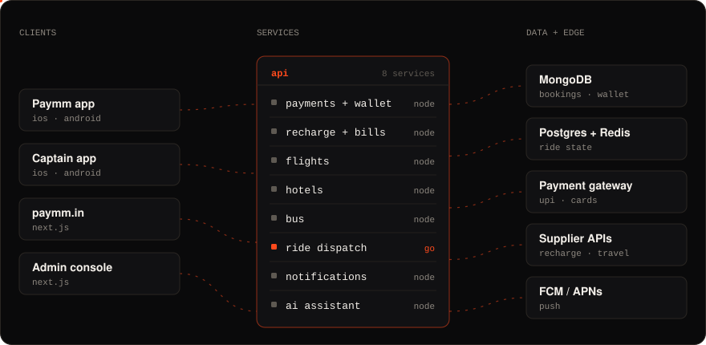
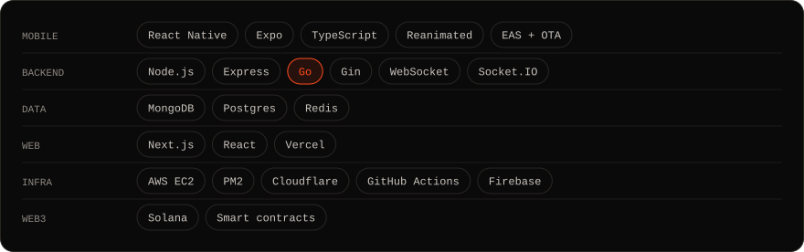

  

  
  
  
  
  

  <strong>Yash Shah</strong> · Full-stack and mobile developer · React Native, Node.js, Go · Indore, India

I'm Yash Shah, a full-stack developer from Indore. I build **Paymm**, an Indian super-app where one wallet pays for mobile recharges, bills, FASTag, flights, hotels, buses and bike-taxi rides. I write the React Native apps, the Node and Go services behind them, and the release pipeline that gets a fix onto phones the same day.

Most of that code is private, so the contribution graph says more than the repo list does.

## In production

  
  

  
  

  
  

## How it fits together

  

## Things I had to get right

- **A recharge that fails at one provider is retried at the next** before the user ever sees an error. If every route says no, the money is back in the wallet without a support ticket.
- **A driver's phone rings full-screen for a new ride even when the app is killed.** Dispatch is push-first, so a swiped-away app still gets the trip.
- **Hotel results arrive batch by batch.** The list fills in as each supplier answers instead of waiting on the slowest one.
- **One JavaScript fix reaches three store versions the same day.** Every over-the-air update is built against each live runtime, so nobody is left on a broken build waiting for review.
- **A payment page that hangs does not strand the user.** If the in-app gateway stalls, checkout falls back to the browser and the booking still completes.

## Toolbox

  

  Indore, India · open to hard problems in payments, travel and real-time systems · <a href="https://www.linkedin.com/in/yash-shah-a83797273">say hi</a>

